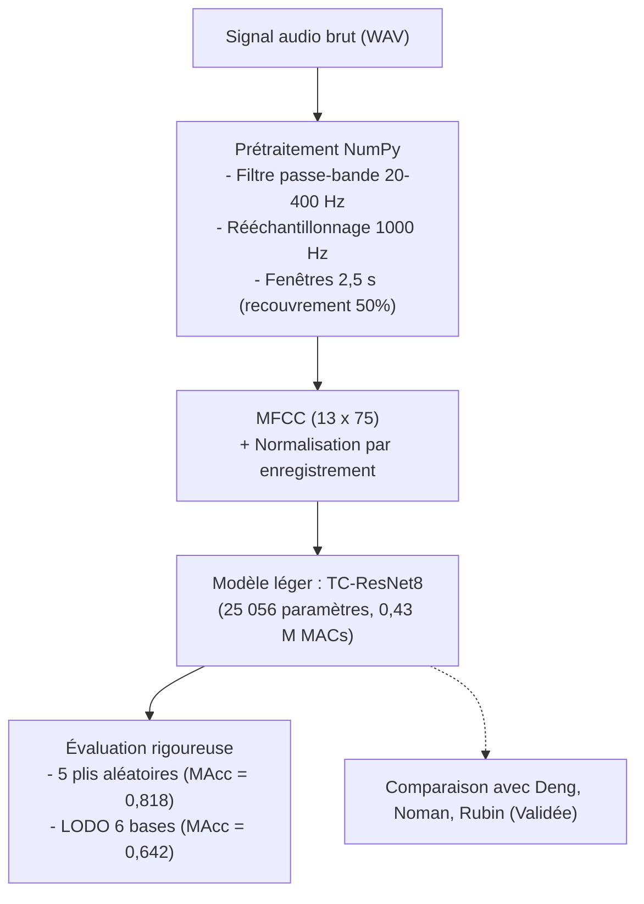
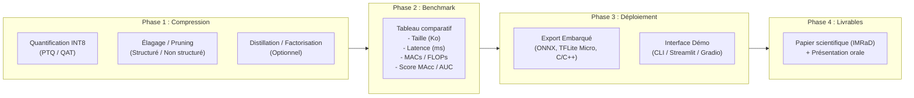

# État des Lieux et Feuille de Route du Projet PCG

> **Formation** : Master 2 Ingénierie en Intelligence Artificielle — Université Paris 8  
> **Module** : Optimisation des modèles  
> **Auteurs** : Adrien LIMACHE, Steve ANTON NELCON, Rania MOULAI HACENE  
> **Branche de travail** : `Adrien`  
> **Dépôt source** : [GitHub - Projet-Detection-d-anomalies-cardiaques-partir-de-signaux-PCG](https://github.com/an-Steve/Projet-Detection-d-anomalies-cardiaques-partir-de-signaux-PCG.git)

---

## 1. Contexte et Objectifs

### 1.1 Problématique médicale et technique
Les maladies cardiovasculaires constituent la première cause de mortalité dans le monde. L'auscultation par **phonocardiogramme (PCG)** permet de capter les bruits mécaniques du cœur de manière non-invasive et à très faible coût.

L'objectif de ce projet est de concevoir un système complet de classification binaire (**Normal / Anormal**) capable de s'exécuter sur un **dispositif embarqué à faibles ressources** (microcontrôleur type ARM Cortex-M, ESP32, Raspberry Pi Pico) pour servir de filtre de dépistage préalable.

### 1.2 Données
* **Base officielle** : PhysioNet / CinC Challenge 2016 (3 240 enregistrements PCG répartis en 6 sous-bases `a` à `f`).
* **Déséquilibre** : Environ 20,5 % d'anormaux globalement, avec de fortes disparités par base (9 % pour `e` à 77 % pour `c`).
* **Métrique officielle** : Modified Accuracy **$\text{MAcc} = \frac{\text{Sensibilité} + \text{Spécificité}}{2}$** et calcul de l'AUC.

---

## 2. Ce qui a déjà été réalisé

Le projet a déjà validé la phase de prétraitement, le choix d'architecture de référence et la comparaison avec l'état de l'art.

### 2.1 Prétraitement et Extraction de Caractéristiques (`pcg/mfcc.py`)
- **Filtre & Échantillonnage** : Sous-échantillonnage de 2 000 Hz à 1 000 Hz ; filtre passe-bande de Butterworth (ordre 3, 20–400 Hz) appliqué sans déphasage temporel (`sosfiltfilt`).
- **Découpage temporel** : Fenêtres de **2,5 secondes** avec 50 % de recouvrement (compromis optimal validé face à 3 s et 5 s).
- **MFCC purs NumPy** : 26 filtres Mel, 13 coefficients conservés (taille par fenêtre : $13 \times 75$). Aucune bibliothèque lourde (`librosa`) n'est utilisée pour garantir la portabilité directe en C/C++ sur microcontrôleur.
- **Normalisation par enregistrement** : Recentrage et mise à l'échelle des MFCC par enregistrement (progrès majeur : fait passer le MAcc en LODO de 0,50 à 0,64).

### 2.2 Architecture retenue : TC-ResNet8 (`pcg/modele.py`)
- Réseau de **convolutions temporelles 1D** avec connexions résiduelles (inspiré de Choi et al., 2019).
- Canaux : `10 -> 15 -> 20 -> 30` (largeur $\times 0,625$).
- **Empreinte** : **25 056 paramètres** et **0,43 M MACs**, soit une architecture nativement compacte.

### 2.3 Entraînement et Comparaisons (`pcg/train.py`, `pcg/modele.py`)
- Entropie croisée pondérée par base, classe et enregistrement. Arrêt anticipé (*early stopping*) sur base complète.
- **Validation Leave-One-Dataset-Out (LODO)** : Évaluation réaliste sur source inconnue (MAcc moyen : **0,642**, comparable aux résultats du challenge PhysioNet à 0,59).
- **Comparaison avec 3 architectures de la littérature** :
  - **TC-ResNet8** : MAcc LODO = 0,642 (25 k param.)
  - **Deng (CRNN)** : MAcc LODO = 0,585 (38 k param.)
  - **Noman (CNN 2D)** : MAcc LODO = 0,589 (23 k param.)
  - **Rubin (CNN 2D)** : MAcc LODO = 0,543 (9 k param.)
- **Variantes testées** : Data augmentation et entraînement contradictoire (*adversarial domain adaptation*). N'ayant pas apporté de gain significatif en LODO, la version de référence a été conservée.

---

## 3. Ce qu'il reste à faire (Feuille de Route)

Le module portant sur **l'optimisation des modèles**, les prochaines étapes doivent se concentrer sur la **compression**, le **déploiement embarqué** et les **livrables académiques**.

### Étape 1 : Techniques de Compression de Modèle
1. **Quantification Post-Entraînement (PTQ) et QAT** :
   - Quantification en entier 8 bits (**INT8**) via `torch.ao.quantization`.
   - Comparaison des poids en Float32 (actuels : ~120 Ko) vs INT8 (~25-30 Ko).
   - Vérification de la non-dégradation du MAcc sur les plis LODO.
2. **Élagage (Pruning)** :
   - Application de masques de sparsité via `torch.nn.utils.prune` (élagage non structuré L1 sur les poids, ou élagage structuré sur les canaux de convolution 1D).
   - Analyse de la courbe performance vs taux de sparsité (ex. 20 %, 40 %, 60 %).
3. **Distillation de connaissances (Knowledge Distillation)** *(selon exigences)* :
   - Entraînement d'un modèle encore plus petit (ex: largeur $\times 0,375$, 9 220 paramètres) guidé par le TC-ResNet8 actuel.

### Étape 2 : Mesures d'Impact et Benchmark Embarqué
- Construire un script d'évaluation systématique comparant :
  - **Taille mémoire** : taille du fichier de poids (.pt, .onnx, .tflite) et RAM active requise.
  - **Complexité calculatoire** : nombre d'opérations (MACs / FLOPs).
  - **Latence d'inférence** : temps de calcul par fenêtre de 2,5 s sur CPU / microcontrôleur simulé.
  - **Précision clinique** : MAcc, Sensibilité, Spécificité, AUC.

### Étape 3 : Export et Déploiement Embarqué
1. **Export vers un format portable** :
   - Export vers **ONNX** (`torch.onnx.export`).
   - Conversion vers **TensorFlow Lite Micro** ou génération directe de code d'inférence **C/C++** (exploitant la bibliothèque CMSIS-NN pour ARM Cortex-M).
2. **Démonstrateur d'inférence** :
   - Extension de `pcg/predire.py` pour accepter le modèle compressé (INT8 / ONNX).
   - Création d'une interface de test simple (ex. script CLI interactif ou démo web locale) pour qualifier un fichier `.wav` inconnu en temps réel.

### Étape 4 : Rédaction et Présentation
- **Papier scientifique** au format académique **IMRaD** (*Introduction, Méthodes, Résultats, Discussion*).
- **Support de présentation orale** (slides) mettant en avant la démarche d'optimisation et les compromis obtenus.

---

## 4. Structure actuelle des fichiers

| Dossier / Fichier | Description | Statut |
|---|---|---|
| `pcg/donnees.py` | Gestion de la base PhysioNet et des découpages LODO / stratifiés | Validé |
| `pcg/mfcc.py` | Prétraitement du signal et calcul MFCC (100% NumPy) | Validé |
| `pcg/modele.py` | Architectures (TC-ResNet8, Rubin, Noman, Deng) | Validé |
| `pcg/train.py` | Entraînement, validation et métriques | Validé |
| `pcg/variantes.py` | Variantes (augmentation, adversaire) | Validé (conservé en option) |
| `pcg/export_onnx.py` | Export et validation numérique vers ONNX standard (statique 13x75) | Validé |
| `pcg/quantifier_tflite.py` | Quantification Post-Entraînement (PTQ) Full INT8 vers TFLite | Validé |
| `pcg/evaluer_tflite.py` | Benchmark métrologique comparatif FP32 vs INT8 sur les 6 bases LODO | Validé |
| `pcg/qat.py` | Quantization-Aware Training (fine-tuning INT8 adaptatif) | Validé |
| `pcg/generer_c_header.py` | Génération de l'en-tête C/C++ `model_data.h` pour microcontrôleur | Validé |
| `deploy/model_data.h` | Tableau d'octets C du modèle INT8 aligné 16 octets + normalisation | Prêt au déploiement |
| `deploy/main_tflite_micro.cpp` | Code firmware C++ complet pour microcontrôleurs (STM32, ESP32, RP2040) | Validé |
| `pcg/predire.py` | Inférence unitaire à partir d'un fichier `.wav` | Validé |
| `models/` | Modèles PyTorch (.pt), ONNX (.onnx) et TFLite quantifiés (.tflite) | Poids FP32 et INT8 prêts |
| `results/` | Rapports d'évaluation métrologique (CSV) | Validé |
| `docs/DECISIONS.docx` | Justifications détaillées des choix et réponses aux remarques | Validé |
| `docs/ETAT_DES_LIEUX.md` | Le présent document de synthèse et feuille de route | Actif |
| `tests/test_projet.py` | Tests unitaires pytest du projet (12 tests) | Validé |
