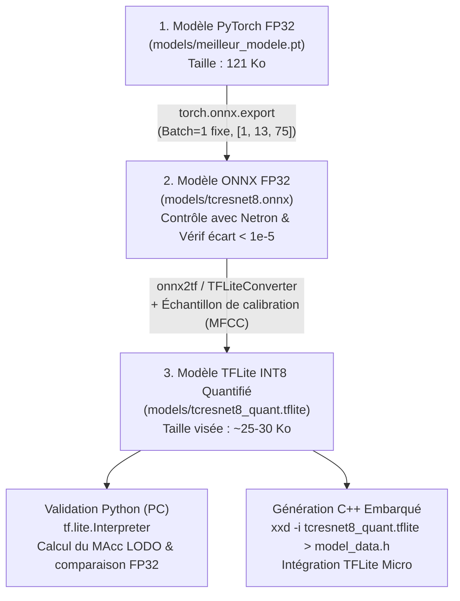

# Spécification et Protocole d'Export : PyTorch ➔ TFLite INT8

> **Auteur** : Adrien LIMACHE  
> **Projet** : Classification PCG sur Cible Embarquée (M2 IIA - Optimisation des modèles)  
> **Statut** : Document de conception soumis pour validation avant implémentation  
> **Fichier cible** : `docs/EXPORT_TFLITE.md`  

---

## 1. Objectifs et Contraintes Matérielles

Le modèle de référence retenu est **TC-ResNet8** ($\times 0,625$, 25 056 paramètres), actuellement sauvegardé au format PyTorch FP32 dans `models/meilleur_modele.pt` (taille fichier : **121 Ko**).

### 1.1 Objectifs de la compression
1. **Réduction mémoire** : Passer le modèle sous la barre des **30 Ko** en entiers signés 8 bits (**INT8**).
2. **Cible matérielle** : Microcontrôleur à mémoire contrainte (type ARM Cortex-M4/M7, ESP32 ou RP2040) avec runtime **TensorFlow Lite for Microcontrollers (TFLite Micro)**.
3. **Maintien des performances cliniques** : La perte d'exactitude équilibrée (**MAcc**) en protocole LODO (*Leave-One-Dataset-Out*) doit être **inférieure ou égale à 1 point** par rapport au score de référence de **0,642** (seuil minimal acceptable : **MAcc $\ge 0,632$**).

---

## 2. Architecture de la Chaîne d'Export

Comme le modèle est développé en **PyTorch** et que la cible finale s'exécute sur **TFLite Micro**, la conversion passe par le standard d'interopérabilité **ONNX** comme format pivot, avant d'engager le convertisseur TFLite officiel avec calibration PTQ (*Post-Training Quantization*).



---

## 3. Détail des Étapes d'Implémentation Proposées

### Étape 1 : Export du modèle PyTorch vers ONNX (`pcg/export_onnx.py`)

* **Dimensions de l'entrée pour l'embarqué** :
  Sur microcontrôleur, le calcul s'effectue fenêtre par fenêtre en temps réel (pas de traitement par lot important). La dimension d'entrée sera donc fixée à une forme statique :  
  $$\text{Forme d'entrée} = [1, 13, 75]$$  
  *(1 fenêtre, 13 coefficients MFCC, 75 pas temporels correspondant à 2,5 secondes)*.

* **Code de l'implémentation prévue** :
  ```python
  import torch
  from pcg.train import charger

  def exporter_onnx(modele_pt="models/meilleur_modele.pt", sortie_onnx="models/tcresnet8.onnx"):
      modele, mu, sd, _ = charger(modele_pt)
      modele.eval()
      
      # Entrée factice (forme statique pour microcontrôleur)
      dummy_input = torch.zeros(1, 13, 75, dtype=torch.float32)
      
      torch.onnx.export(
          modele,
          dummy_input,
          sortie_onnx,
          export_params=True,
          opset_version=13,
          do_constant_folding=True,
          input_names=["entree_mfcc"],
          output_names=["score_anomalie"]
      )
  ```

* **Vérification d'intégrité numérique** :
  Un test unitaire comparera la sortie de PyTorch et celle de l'interpréteur ONNX sur 100 entrées aléatoires pour garantir :
  $$\max |\text{Sortie}_{\text{PyTorch}} - \text{Sortie}_{\text{ONNX}}| < 10^{-5}$$

---

### Étape 2 : Quantification Post-Entraînement INT8 vers TFLite (`pcg/quantifier_tflite.py`)

La quantification complète en entiers 8 bits (*Full Integer Quantization*) requiert un **jeu de données représentatif** pour calibrer la plage dynamique des activations internes du réseau.

* **Jeu de calibration** :
  Un échantillon représentatif de 200 à 300 fenêtres MFCC extraites du jeu d'entraînement (`data/mfcc_2.5/features.npy`).
* **Configuration du convertisseur TFLite** :
  - `converter.optimizations = [tf.lite.Optimize.DEFAULT]`
  - `converter.target_spec.supported_ops = [tf.lite.OpsSet.TFLITE_BUILTINS_INT8]`
  - `converter.inference_input_type = tf.int8` (ou `tf.float32` si le scaling est pris en charge en amont)
  - `converter.inference_output_type = tf.int8` (ou `tf.float32` pour récupérer la probabilité brute)
  - `converter.representative_dataset = generateur_calibration`

* **Sortie produite** : `models/tcresnet8_quant.tflite` (pesant environ 25 à 30 Ko).

---

### Étape 3 : Évaluation rigoureuse du MAcc LODO (`pcg/evaluer_tflite.py`)

Avant tout déploiement sur la carte, le modèle `.tflite` quantifié doit être évalué sur les données de test PhysioNet sous Python avec `tf.lite.Interpreter`.

* **Protocole d'évaluation** :
  1. Évaluation sur les 6 bases en Leave-One-Dataset-Out (`lodo_a` à `lodo_f`).
  2. Calcul des métriques : $\text{MAcc}$, $\text{Sensibilité}$, $\text{Spécificité}$, $\text{AUC}$.
  3. Tableau comparatif :
     | Métrique | TC-ResNet8 FP32 (PyTorch) | TC-ResNet8 INT8 (TFLite) | Écart | Statut |
     |---|---|---|---|---|
     | **Taille disque** | 121,7 Ko | ~26,0 Ko | **-78 %** | Conforme |
     | **MAcc LODO** | **0,642** | *À mesurer* | $\le 0,01$ attendu | À valider |
     | **Sensibilité** | 0,687 | *À mesurer* | - | - |
     | **Spécificité** | 0,597 | *À mesurer* | - | - |

* **Règle de décision** :
  - Si $\text{Perte MAcc} \le 0,01$ : **PTQ validée**. On passe au déploiement microcontrôleur.
  - Si $\text{Perte MAcc} > 0,01$ : **Passage au QAT** (*Quantization-Aware Training* sous PyTorch avant ré-export).

---

### Étape 4 : Déploiement C++ sur Microcontrôleur (`deploy/`)

Pour flasher le modèle sur la cible physique :
1. **Conversion en en-tête C** :
   ```bash
   xxd -i models/tcresnet8_quant.tflite > deploy/model_data.h
   ```
   Ce fichier définit un tableau statique `unsigned char g_model[]` stocké en mémoire Flash.
2. **Squelette TFLite Micro** :
   Un fichier `deploy/inference_mcu.cpp` instancie le *MicroInterpreter*, alloue le tenseur d'arène (*Tensor Arena*, budgetisé à ~15 Ko de RAM), injecte les MFCC et exécute `Invoke()`.

---

## 4. Prise en compte de la remarque sur la normalisation en streaming

Comme l'a souligné votre collègue dans `note.txt`, la normalisation actuelle calcule la moyenne et l'écart-type sur l'enregistrement entier (ex. 30 secondes), ce qui est incompatible avec la mémoire vive d'un microcontrôleur.

Deux variantes seront préparées pour le test d'inférence en continu :
1. **Normalisation locale par fenêtre (2,5 s)** : calcul de la moyenne et de la variance sur la fenêtre active uniquement ($13 \times 75$ points).
2. **Moyenne mobile exponentielle (EMA)** : mise à jour des statistiques au fil de l'eau avec un coefficient d'oubli $\alpha = 0,05$.

L'impact sur le MAcc sera mesuré comparativement à la normalisation globale.

---

## 5. Points de validation demandés avant lancement

Merci d'indiquer si vous validez les choix techniques suivants :
- [ ] **Format pivot ONNX** validé pour la transition PyTorch ➔ TFLite.
- [ ] **Quantification INT8 complète (Full INT8)** avec jeu de calibration issu des MFCC réels.
- [ ] **Forme d'entrée statique `[1, 13, 75]`** correspondant à une fenêtre unique pour l'inférence temps réel sur carte.
- [ ] **Seuil d'acceptabilité fixé à 1 point de MAcc maximum** pour valider la PTQ avant d'envisager le QAT.
