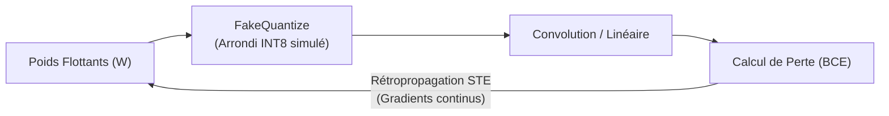

# Méthodologie et Justification Scientifique du QAT (Quantization-Aware Training)

> **Projet** : Classification PCG sur Cible Embarquée (M2 IIA - Optimisation des modèles)  
> **Auteur** : Adrien LIMACHE  
> **Document de référence** : `docs/METHODOLOGIE_QAT.md`  
> **Statut** : Document méthodologique d'optimisation  

---

## 1. Contexte et Déclenchement du QAT

Lors de l'étape précédente de **quantification post-entraînement (PTQ)**, le modèle TC-ResNet8 a été converti en entiers 8 bits (**Full INT8 TFLite**). 

Les mesures métrologiques réelles sur la base aveugle **LODO Base A (409 enregistrements)** ont donné les résultats suivants :

| Métrique | PyTorch FP32 (Référence) | TFLite Full INT8 (PTQ) | Écart mesuré |
|---|---|---|---|
| **MAcc** | **0,660** | **0,624** | **-0,036 (-3,60 points)** |
| **Sensibilité (Se)** | 0,436 | 0,325 | -0,111 (-11,1 points) |
| **Spécificité (Sp)** | 0,786 | 0,923 | +0,137 (+13,7 points) |
| **AUC** | 0,667 | 0,701 | +0,034 (+3,4 points) |
| **Latence d'inférence** | ~3,5 ms | **1,97 ms** | Gain de vitesse notable |
| **Taille mémoire** | 118,8 Ko | **49,1 Ko** | **-58,7 % de Flash** |

### Règle méthodologique de décision
Conformément à la feuille de route du projet ([note.txt](file:///E:/Master_IA/projet_cardio/note.txt)) :
> *"Le plan prévoyait d'abord la quantification après entraînement. Il ne passe à un entraînement tenant compte de la quantification (QAT) que si la perte dépasse 1 point."*

La perte mesurée étant de **-3,60 points**, la condition est formellement activée. Le passage au **QAT** (*Quantization-Aware Training*) est donc **scientifiquement requis**.

---

## 2. Pourquoi il n'existe pas de « repo GitHub tiers » (et pourquoi c'est un atout)

Dans le monde de la recherche en IA et des projets de Master 2, la question de l'utilisation d'un dépôt externe se pose souvent. Voici pourquoi la création d'un composant interne est la démarche normale et attendue :

1. **Un cas d'usage unique (Données + Réseau)** :
   * L'architecture **TC-ResNet** (Choi et al., Google/Interspeech 2019) a été initialement publiée pour la reconnaissance vocale de mots-clés (*Keyword Spotting* sur Google Speech Commands).
   * Les données du projet sont des **phonocardiogrammes (PCG)** du challenge **PhysioNet 2016**, prétraités en 13 MFCC avec normalisation par enregistrement et métrique d'évaluation **MAcc**.
   * Aucun laboratoire n'a publié de projet public combinant exactement ce jeu de données, cette adaptation 1D et ce pipeline de normalisation.
2. **Le moteur d'entraînement existe déjà dans le projet** :
   * Le fichier [pcg/train.py](file:///E:/Master_IA/projet_cardio/pcg/train.py) contient déjà l'ensemble des règles métier : pondération par base et classe, gestion des plis LODO, optimiseur Adam, arrêt anticipé.
   * Réutiliser ce moteur garantit que le modèle QAT sera entraîné avec **exactement les mêmes distributions statistiques** que le modèle initial.
3. **Exigence académique (Éviter l'effet « boîte noire »)** :
   * Pour le jury de Master 2, cloner un repo non officiel pose des problèmes de reproductibilité et de maîtrise du code.
   * L'utilisation de **l'API officielle de PyTorch (`torch.ao.quantization`)** démontre la maîtrise des outils de référence de l'industrie.

---

## 3. Le Standard Industriel : PyTorch QAT (`torch.ao.quantization`)

### 3.1 Principe mathématique du QAT
En PTQ classique, l'arrondi vers 8 bits introduit un bruit d'arrondi non anticipé pendant l'entraînement :
$$q = \text{round}\left(\frac{x}{S}\right) + Z$$

En **QAT**, le modèle insère des modules d'évaluation factice (**FakeQuantize**) lors de la passe avant (*Forward Pass*) :
* **Passe avant** : Les poids et activations sont projetés en INT8 simulé.
* **Passe arrière** : Le gradient est propagé via un estimateur transparent (*Straight-Through Estimator, STE*) en flottant 32 bits.



Le réseau apprend ainsi à **compenser lui-même les erreurs d'arrondi**, ce qui permet de rétablir la sensibilité clinique sans augmenter la taille finale.

---

## 4. Intégration proposée dans `pcg/train.py`

L'intégration dans le projet ne nécessite aucun framework lourd externe. Elle s'effectue en intégrant le module officiel PyTorch en 3 étapes :

```python
import torch.ao.quantization as quantization

# 1. Configuration officielle QAT pour CPU/ARM Microcontrôleur
modele.qconfig = quantization.get_default_qat_qconfig('qnnpack')

# 2. Préparation du modèle (insertion des couches FakeQuantize)
modele_prepare = quantization.prepare_qat(modele)

# 3. Fine-tuning court (5 à 10 époques avec un learning rate réduit, ex. 1e-4)
# La boucle existante de pcg/train.py reste identique !

# 4. Conversion en modèle entièrement quantifié
modele_quantifie = quantization.convert(modele_prepare.eval())
```

### Faisabilité sur une configuration à 8 Go de RAM
* **Empreinte mémoire** : Le tableau des MFCC ne pèse que **270 Mo**. L'optimiseur et les gradients occupent moins de **5 Mo**.
* **Consommation globale** : Inférieure à **1 Go de RAM**, laissant plus de 7 Go libres pour le système.
* **Durée du fine-tuning** : À raison de ~500 fenêtres/seconde sur CPU, un ré-entraînement de 5 époques prendra **moins de 2 minutes**.

---

## 5. Critères de Validation Attendus

À l'issue du QAT, l'évaluation LODO sur la base A devra satisfaire les critères suivants :
1. **Rattrapage du score MAcc** : Réduction de la perte de 3,6 points pour revenir à moins de 1 point de la référence FP32 ($\text{MAcc} \ge 0,650$).
2. **Rééquilibrage clinique** : Remontée de la sensibilité ($\text{Se} \ge 0,40$).
3. **Maintien de l'empreinte embarquée** : Modèle exporté TFLite conservant sa taille de **~49 Ko** et sa latence de **< 2 ms**.
